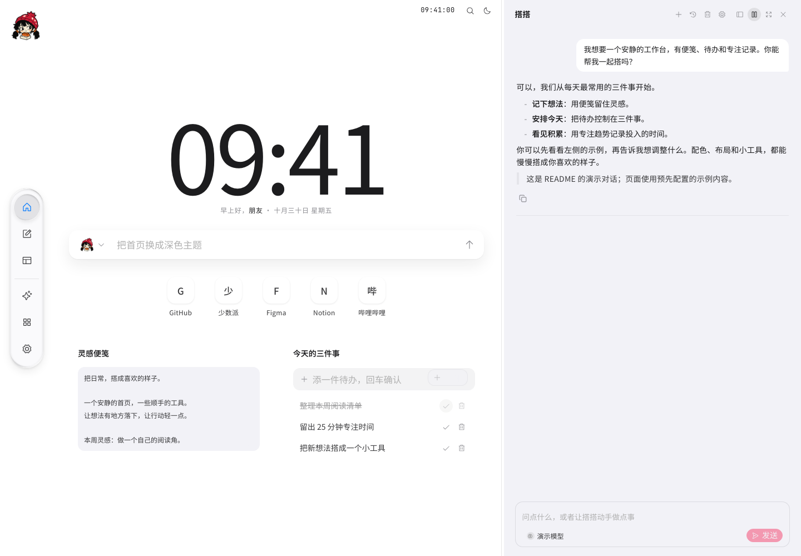
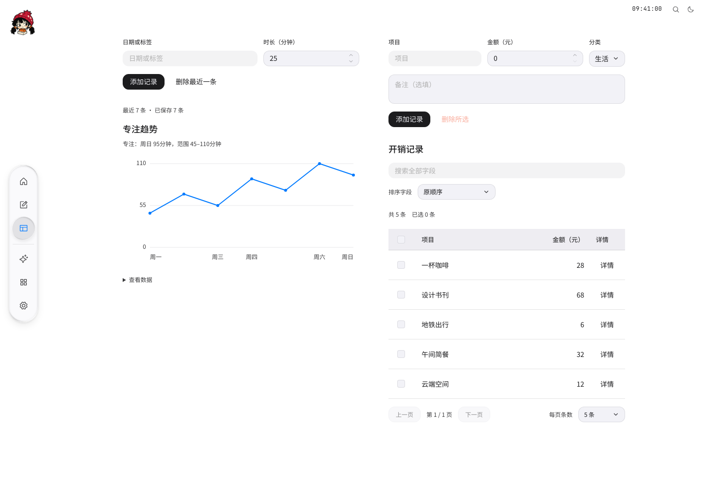
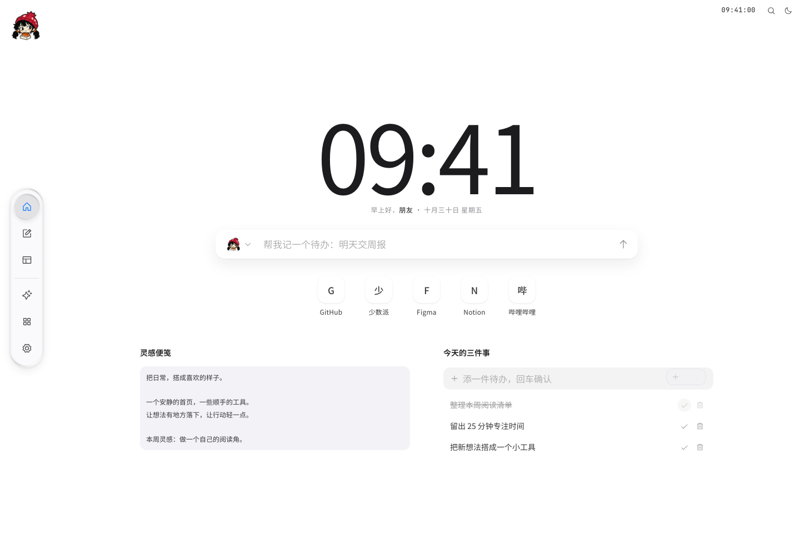
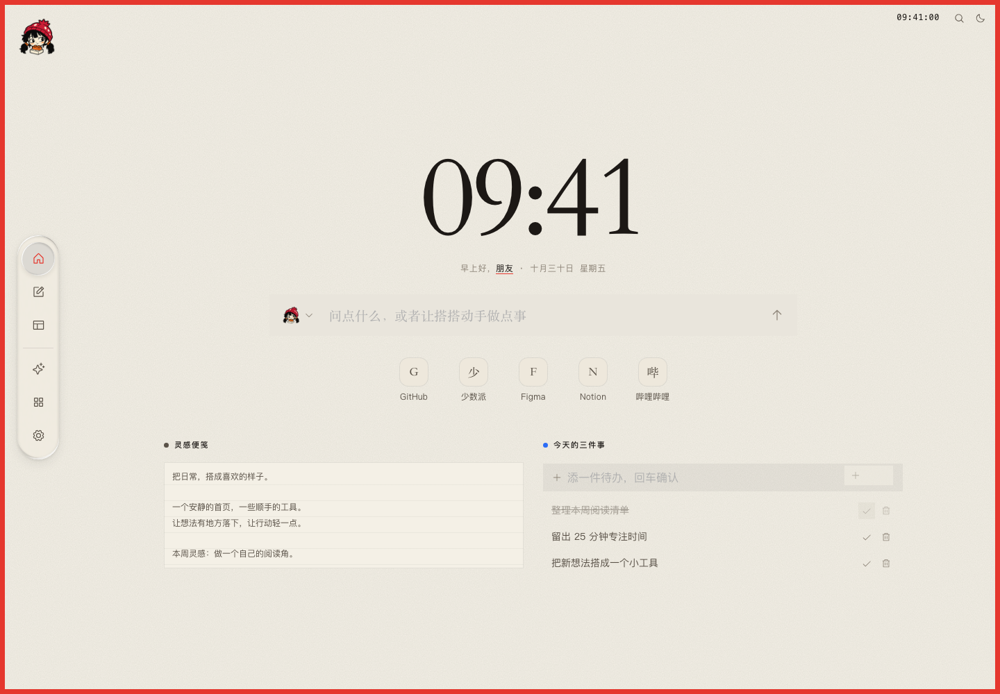
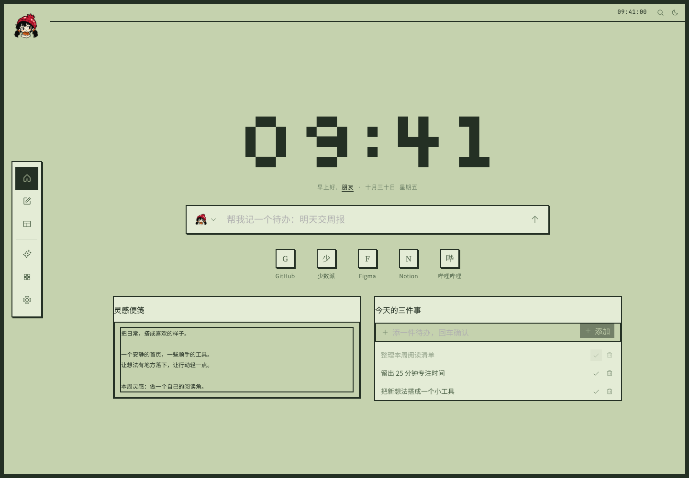
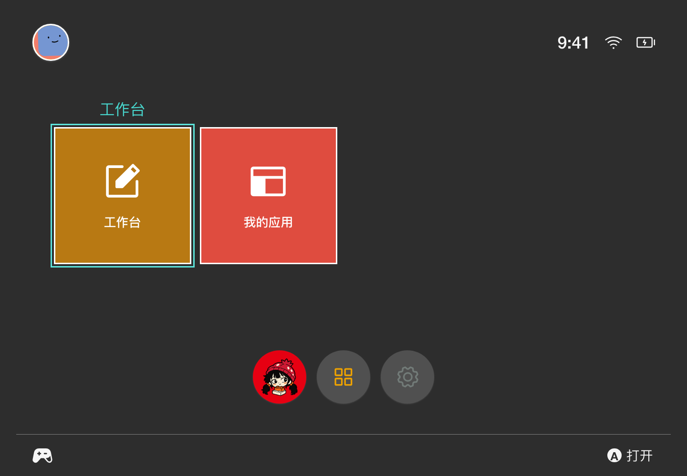
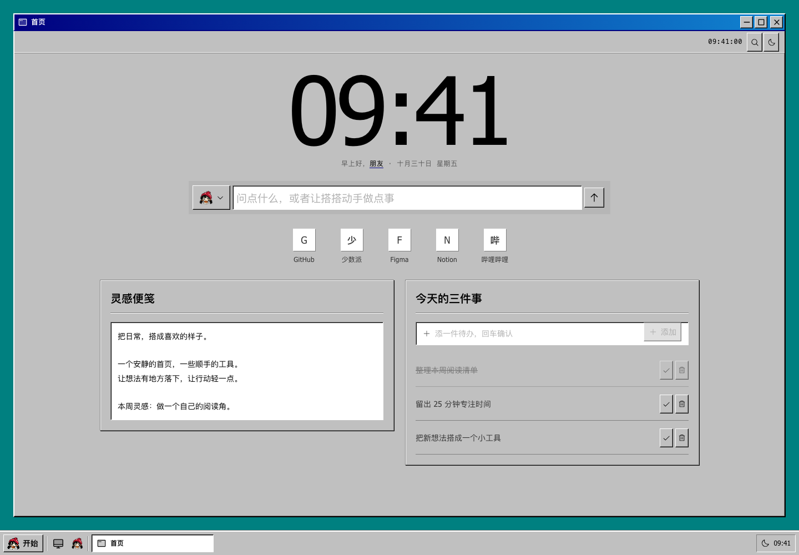
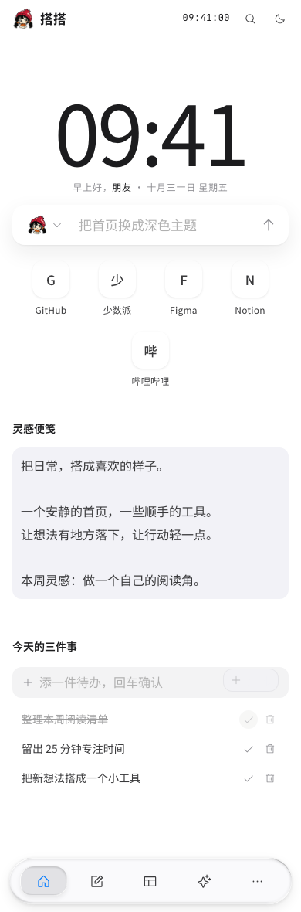

<div align="center">
  
  <h1>搭搭</h1>
  <p><strong>陪你把想法，搭成自己的主页。</strong></p>
  <p>AI 搭建 · 个人工作台 · 可生长的小应用</p>

  <a href="https://vercel.com/new/clone?repository-url=https%3A%2F%2Fgithub.com%2Ftulai-design%2Fdada-home&project-name=dada-home"></a>

  <p>
    <a href="#快速开始">快速开始</a> ·
    <a href="#看看搭搭能做什么">功能一览</a> ·
    <a href="#五种性格同一个空间">主题画廊</a> ·
    <a href="docs/guides/deployment.md">部署指南</a> ·
    <a href="docs/guides/usage.md">完整使用指南</a>
  </p>
</div>

<p align="center"><a href="docs/images/readme/hero.png"></a></p>

**搭搭是一个本地优先、可以自己部署的 AI 个人主页搭建助手。** 你可以像整理桌面一样安排页面、订阅和小工具，也可以直接告诉它：“给我做一个安静的阅读主页”“做一个能记住记录的开销工具”。搭搭会利用已注册的组件、主题和工具，把这些想法变成可继续修改的工作空间。

从一个简洁的新标签页开始，逐渐长成你的阅读角、日常工作台，甚至一组专属应用。配置和数据保存在自己的浏览器，模型、搜索和同步服务由自己选择；不配置 AI，也能手动搭建和使用本地功能。

> 本文图片来自真实应用界面，使用独立环境中的演示配置与合成数据。AI 对话和应用示例用于展示交互形态，不代表某个在线模型或外部服务的实时结果。

## 看看搭搭能做什么

| 想做的事 | 搭搭提供的能力 |
| --- | --- |
| 打开浏览器，先看到自己关心的东西 | 搜索、时钟、天气、常用链接、书签与多页面导航 |
| 把阅读集中到一处 | RSS 订阅、热榜、阅读器、AI 摘要与带文章提问 |
| 安排自己的日常 | 待办、便签、日历、日程、倒计时、番茄钟与音乐 |
| 用一句话调整主页 | AI 编辑页面、组件、布局、主题、模板和站内数据 |
| 不想立刻覆盖现有设计 | 四类首页方向、静态布局草稿、检查、应用与撤销 |
| 为小需求做一个专用工具 | 声明式组件、Applet 小程序、HTML 沙盒 App |
| 让主页有自己的性格 | 五套内置主题、浅深色、字体、壁纸、Dock 和特效 |
| 把数据带到另一台设备 | 完整备份、配置快照、完整快照及可选加密增量同步 |
| 像应用一样随手打开 | Web、PWA 安装、Chrome / Edge 新标签页扩展 |

## 从一句话，到自己的工作空间

<p align="center"><a href="docs/images/readme/ai-workspace.png"></a></p>

搭搭的 AI 可以直接使用站内工具：读取当前工作空间，查找已有组件，创建页面、调整分区、整理书签，或制作一个新的应用。改动进入可撤销的工作空间操作，涉及高风险动作时按权限设置确认。

你可以从这些需求开始：

```text
给我做一个安静的阅读主页，保留搜索和常用书签。

把待办、便签和本周日程放在一起，适合窄屏使用。

做一个开销记录小程序，能分类、搜索，并查看本月趋势。

切换到掌机主题，保留现在的内容和布局。
```

- **边聊边看**：抽屉、分栏与全屏对话；桌面分栏可调整比例。
- **先试再应用**：极简启动、效率工作、编辑式内容、视觉展示四类首页草稿，可取消、应用或撤销。
- **让回答接上上下文**：多轮聊天、文章参考、用户画像、性格与记忆；历史按需加载。
- **连接自己的模型**：支持 OpenAI Chat Completions 与 Anthropic Messages 协议，可选推理参数和工具调用模型。
- **按需联网**：联网搜索单独配置，支持 Tavily、Firecrawl、SearXNG、Exa、Brave 等服务。

AI 需要自行配置接口、模型和 API Key，页面搭建需要模型支持工具调用。草稿展示静态布局；页面检查工具提供有限 DOM 测量，不具备截图或审美判断。详细配置见[使用指南](docs/guides/usage.md#ai-助手)。

## 不止是组件，还能做自己的应用

<p align="center"><a href="docs/images/readme/applications.png"></a></p>

常用功能直接用内置组件；特殊需求可以让搭搭制作一个独立小工具。应用有自己的设置和业务数据，可以放在页面里，也可以从 Dock 或状态栏打开。

| 方式 | 适合什么 | 如何运行 |
| --- | --- | --- |
| 声明式组件 | 列表、卡片、数字、链接、文字与 SVG 插图 | 由宿主解释数据与展示规格 |
| Applet 小程序 | 记录、换算、计算器、表格和趋势工具 | 隔离执行逻辑，使用统一界面积木 |
| 沙盒 App | 游戏、Canvas / WebGL 与自定义交互 | 在隔离 iframe 里运行 HTML / CSS / JavaScript |

应用支持弹窗、抽屉和全页面，也可以挂成页面小组件。桌面窗口可以拖动、最小化和最大化；应用目录支持分组、搜索、设置与卸载。

Applet 提供趋势折线图、简单柱状图和带搜索、排序、分页及稳定选择的数据表。应用设置与业务状态分开保存，切换打开方式不需要重新录入数据。应用只在挂载时运行，不承诺关闭页面后继续执行后台任务。

## 五种性格，同一个空间

新工作空间默认是 **iOS 主题 + 玻璃 Dock**。从清爽的系统界面，到纸张、掌机、主机和复古桌面，切换主题不需要换掉页面内容。每套主题都有浅色与深色模式，也可以继续定制配色、字体、窗口外框和壁纸。

<table>
  <tr>
    <td width="50%"><a href="docs/images/readme/theme-ios.png"></a><br /><strong>iOS</strong> · 清爽分组与玻璃质感</td>
    <td width="50%"><a href="docs/images/readme/theme-paper.png"></a><br /><strong>纸张</strong> · 米白、墨色与红色点缀</td>
  </tr>
  <tr>
    <td><a href="docs/images/readme/theme-pixel.png"></a><br /><strong>掌机</strong> · 灰绿液晶与像素硬边</td>
    <td><a href="docs/images/readme/theme-switch.png"></a><br /><strong>主机</strong> · 横排封面与系统菜单</td>
  </tr>
  <tr>
    <td colspan="2" align="center"><a href="docs/images/readme/theme-win98.png"></a><br /><strong>Windows 98</strong> · 桌面、开始菜单与复古窗口</td>
  </tr>
</table>

Dock 可以选择玻璃、纸质卡片或通栏等外观。特效素材覆盖背景、文字、卡片和 3D 场景，宿主根据组合预算、页面可见性和减少动画偏好管理运行。满意的页面设计可以存成模板；想重新开始外观时，也能保留内容和数据恢复默认。

## 从桌面到手边

<p align="center"><a href="docs/images/readme/mobile.png"></a></p>

页面、助手和应用会根据实际容器调整布局，兼顾手机、窄抽屉和桌面分栏。可以在支持的浏览器中将 PWA 安装到桌面或主屏幕，也可以把搭搭设为浏览器的新标签页。

**Chrome / Edge 新标签页扩展**在「设置 → 浏览器扩展」下载 ZIP，解压后通过开发者模式加载。完整主页在浏览器本地运行，保留主题、AI、应用、书签与同步入口，当前未上架扩展商店。

扩展目前采用一个完整运行实例：额外新标签页可以“回到搭搭”，原页关闭后再接续。网页版与扩展数据独立，可用备份或同步转移；更新时保留原扩展，避免卸载清除数据。安装细节见[使用指南](docs/guides/usage.md#浏览器扩展)。

## 数据留在自己手里

搭搭没有必需的账号系统或应用业务后端。工作空间与设置保存在 localStorage，组件、AI 应用和聊天业务数据保存在 IndexedDB；关闭同步时仍完整支持本地使用。

| 方式 | 适合的场景 | 范围与特点 |
| --- | --- | --- |
| 导出 / 导入备份 | 换浏览器、迁移或保留副本 | 完整备份包含配置、业务数据与聊天；导入会整体替换当前数据 |
| GitHub Gist | 在设备间带上页面设计 | 配置、主题、应用源码与设置，不含聊天和业务状态 |
| WebDAV / 自建 HTTP | 使用自己的存储 | 完整业务快照；可加密，仍按整包传输 |
| 自建同步服务 | 持续增长的多设备数据 | 客户端加密、持久变更队列、增量传输与冲突选择 |

自动同步负责上传，手动同步会拉取。同步不是多人实时协作；同记录冲突、快照后端并发能力和加密范围各有明确边界。完整说明见[数据与同步指南](docs/guides/usage.md#本地数据与备份)。

本地优先也意味着：清除站点数据、换域名或卸载扩展不会自动带走原数据，请定期备份。AI、搜索、订阅和同步请求会发送到相应服务；模型密钥只应填写在可信设备上。见[隐私政策](public/privacy.html)。

## 快速开始

### 一键部署到 Vercel

[](https://vercel.com/new/clone?repository-url=https%3A%2F%2Fgithub.com%2Ftulai-design%2Fdada-home&project-name=dada-home)

点击按钮，将仓库克隆到自己的账号并创建项目。仓库提供 Web 构建与同源取数函数配置；部署完成后，在应用设置里连接自己的模型与服务即可。Vercel 部署不包含独立的增量同步服务，平台额度与函数限制以自己的套餐为准。配置说明见[部署指南](docs/guides/deployment.md)。

### 本地运行

建议使用 **Node.js 24** 和与仓库锁文件匹配的 pnpm，CI 当前使用 Node.js 24.11.0。

```sh
git clone https://github.com/tulai-design/dada-home.git
cd dada-home
pnpm install --frozen-lockfile
pnpm dev
```

打开 `http://localhost:5173`。随后可以：

1. 在组件市场添加需要的小工具，按需创建自己的页面。
2. 在「设置 → 外观」选择主题，在「设置 → 搭搭 AI」连接模型。
3. 试着让搭搭调整主页，满意后保存模板或导出备份。

### 选择自己的部署方式

| 方式 | 适合谁 | 入口 |
| --- | --- | --- |
| Vercel | 想快速拥有自己的站点 | 上方一键部署按钮 |
| Docker / Compose | 已有服务器，想一并运行取数代理 | `docker compose up -d` |
| Coolify | 想用可视化面板管理域名、HTTPS 和服务 | [Coolify Compose](docker-compose.coolify.yml) |
| 静态托管 | 已有静态站点空间 | 构建后上传 `dist/`，另配置取数代理 |
| 浏览器扩展 | 想把搭搭作为个人新标签页 | 「设置 → 浏览器扩展」下载安装 |

`pnpm build` 同时生成 Web/PWA、完整扩展目录和下载 ZIP。Docker 镜像默认将站点映射到本机 `8080`；Vercel、Docker、纯静态托管与 Worker 的取数差异见[部署指南](docs/guides/deployment.md)。

## 常见问题

<details>
<summary><strong>没有 AI Key，能不能用？</strong></summary>

可以。页面编辑、主题、模板、便签、待办及其他本地工具不依赖模型。AI 对话、AI 搭建和摘要需要配置模型，天气、订阅等在线组件需要网络和对应来源。

</details>

<details>
<summary><strong>支持哪些模型？</strong></summary>

搭搭支持 OpenAI Chat Completions 与 Anthropic Messages 协议，可接入兼容服务或自己的网关。实际可用模型、跨域策略、工具调用和推理能力取决于服务商；部署搭搭不会附送模型额度。参数细节见[使用指南](docs/guides/usage.md#ai-助手)。

</details>

<details>
<summary><strong>能完全离线使用吗？</strong></summary>

已安装并缓存的 PWA 可以离线启动，本地内容与工具可以继续使用。AI、RSS、热榜、天气、在线搜索、同步和未缓存的远程资源仍需要网络；它不是内置离线模型的应用。

</details>

<details>
<summary><strong>为什么 RSS / 热榜需要代理？</strong></summary>

很多来源不允许浏览器直接跨域读取。开发服务器、Docker 和 Vercel 接入同源取数路径，纯静态托管需要另配代理。它只用于公共 HTTP(S) GET 取数，不能拿来代替 WebDAV / HTTP 的同步写入接口。扩展按来源授权直连。排查方法见[部署指南](docs/guides/deployment.md)。

</details>

<details>
<summary><strong>备份、模板和同步有什么区别？</strong></summary>

模板用于复用页面设计；完整备份用于迁移和恢复配置、业务数据与聊天；同步用于多设备交换记录。导入备份会替换当前数据，模板不包含全部业务数据，同步也不能代替独立备份。

</details>

<details>
<summary><strong>AI 制作的应用能访问我的浏览器吗？</strong></summary>

App / Applet 在隔离沙盒中执行，通过宿主协议保存数据、请求网络和调用能力。访问新域名需要授权，不能直接获得扩展 API。用户仍应检查生成源码和它请求的权限；安装一个工具不等于为它授予任意访问能力。

</details>

## 为开发者准备

搭搭采用 **React 19 · TypeScript · Vite · Lobe UI · Phosphor Icons**。页面与应用由可序列化的工作空间模型驱动，组件通过统一协议注册，AI 通过工具操作工作空间。Applet 使用宿主界面积木，App 使用隔离文档；结构、设置和业务数据各自管理。

```sh
pnpm exec tsc --noEmit
pnpm test
pnpm build
```

| 文档 | 内容 |
| --- | --- |
| [完整使用指南](docs/guides/usage.md) | 模型配置、对话、应用、备份、同步、扩展与快捷键 |
| [部署指南](docs/guides/deployment.md) | Vercel、Docker、Coolify、静态站点、代理与 PWA |
| [开发指南](docs/guides/development.md) | 环境、命令、源码地图、组件扩展与测试入口 |
| [设计规范](docs/design-system.md) | 主题、布局、应用形态与界面约定 |
| [文档中心](docs/README.md) | 产品、运行时契约、架构决策和工作记录 |
| [可选品牌图提示词](docs/brand/readme-art-prompts.md) | 以搭搭 IP 为主体的封面、海报与小插画方向 |

## 关于搭搭

搭搭来自[图来设计 · tulai.design](https://tulai.design)。我们希望让原本需要反复配置、编写代码的小需求，变成可以直接表达、慢慢调整的日常工具。

**从一个新标签页开始，把自己的数字空间一点点搭起来。**
