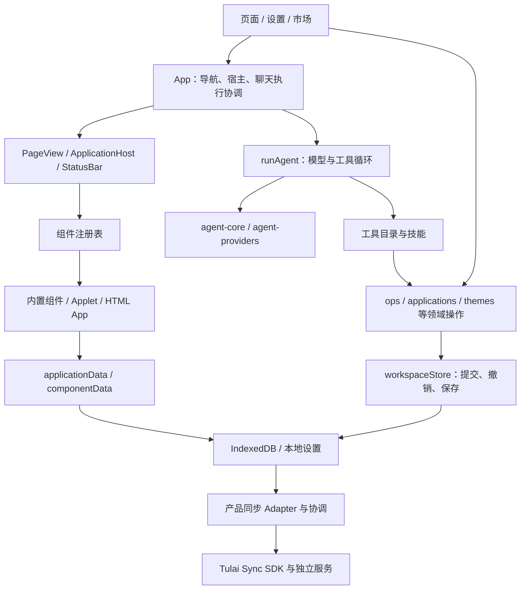

# 架构与扩展性评估

日期：2026-10-29。源码基线：`0f63fe3`，分支 `main`。本文是架构评估与演进建议，未批准的新接口和目录均为建议，不代表已实现。评估当轮没有修改业务代码，后续实施状态单独记录如下。

## 实施状态（2026-10-30）

**A1、A2 已修复。** 以下“现状证据”和隔离复现保留为评估基线的历史记录，不再描述当前行为。A3–A7 仍是待实施建议。

- A1：取消贯穿模型、审批和工具批次；待决审批可终止，独立审批 ID 经聊天状态规整后仍有效，旧答复不能执行或添加永久授权。异步写入在提交前或下一批请求前检查取消，已发出的不可取消操作等待结束，保留已发生效果。
- A2：主工具及站点、生活、搜索工具保留异常到统一分发层，领域拒绝等产生 `ok:false`，模型仍获得解释。正常空结果保持成功，不通过中文文字判断成败。
- 回归入口：[执行行为](../../../scripts/test-agent-execution.mjs)、[真实 App 双协议验证](../../../scripts/test-agent-execution-browser.mjs)、[聊天流程](../../../scripts/test-assistant-flows.mjs)。任务证据见[验证记录](../../../.trellis/tasks/archive/2026-10/10-30-agent-execution-correctness/verification.md)；当前执行合同见[运行时契约](../../specs/runtime-contract.md#ai-执行审批与停止)。

## 总体判断

当前架构适合继续作为本地优先、由 AI 帮助搭建的个人数字空间发展。页面数据化、领域纯操作、受控能力目录、应用沙盒和存储分离是值得保留的基础。单个 React 项目与独立的 AI 基础包、同步服务的组合也符合当前规模。

扩展成本开始明显分化：增加一套配色、一个普通 Applet 或一种既有领域工具，已有明确入口；增加会改变导航的桌面皮肤、独立 Agent 角色、多运行实例或后台任务，会触及集中在主应用中的状态与全局单例。我的判断是：**基础合理，适合继续增长；需要在下一轮大功能前收拢几个已出现重复实现的接口，尚不需要整体重写。**

| 扩展方向 | 当前评价 | 主要原因 |
| --- | --- | --- |
| 配色、字体、明暗主题 | 较好 | 主题是可导出、可撤销的数据，宿主与 App 共用变量 |
| 改变桌面交互的皮肤 | 扩展成本偏高 | 主题 ID 同时决定导航、窗口、首页和设置行为 |
| 现有 Agent 增加工具或技能 | 可用，维护面在扩大 | 有工具合同和按需技能，但总目录、提示词、审批描述仍需跨处维护 |
| 多角色、并发或后台 Agent | 当前没有完整支撑 | 执行依赖 React 状态、全局业务存储和单次聊天循环 |
| 新建 AI 应用 | 较好 | App/Applet、安装记录、五种形态和独立业务存储已建立 |
| 新增应用运行器或开放分发 | 需要先补合同 | 当前运行器固定为两类，权限与生命周期没有独立的应用级描述 |
| 新增业务数据与同步类别 | 有良好基础，接入需谨慎 | 已有事务、保存屏障和同步 Adapter；各数据路径仍有不同策略 |

## 当前架构关系

下图表示主要调用与职责关系，不表示每个源码 import：

### 应继续保留的设计

1. **页面由数据描述。** [workspace.ts](../../../src/lib/workspace.ts#L1) 把页面、组件实例、应用和主题保存为可序列化模型；[PageView](../../../src/components/PageView.tsx#L21) 负责解释。AI 修改的是模型，布局和业务组件因此能够分别演进。
2. **领域操作与提交分开。** [applications.ts](../../../src/lib/applications.ts#L203)、[themes.ts](../../../src/lib/themes.ts#L145) 返回新结构，[workspaceStore.commit](../../../src/lib/workspaceStore.ts#L295) 管理历史与持久化。UI 和工具可以复用相同行为，扩展时应沿用这条路径。
3. **受控 Applet 与自由 App 分档。** Applet 的逻辑在沙盒中运行、UI 由宿主积木渲染；HTML App 提供特殊视觉能力。[runner](../../../src/lib/applet/runner.ts#L204) 和 [App 文档生成](../../../src/widgets/app.tsx#L141) 实际设置了 CSP，iframe 使用 `allow-scripts` 且不带 `allow-same-origin`。这比所有应用直接执行宿主 React 代码更容易集中维护。
4. **安装、挂载和数据身份分离。** [GeneratedApplication](../../../src/lib/workspace.ts#L103)、[mountApplication](../../../src/lib/applications.ts#L219) 和 [applicationInstance](../../../src/lib/applications.ts#L238) 允许同一安装记录用于不同入口与形态；卸载保留业务数据是当前明确语义。
5. **可靠保存已成为专门职责。** [applicationData](../../../src/lib/applicationData.ts#L30) 保留待写版本并等待提交确认；[applicationSyncStore](../../../src/lib/applicationSyncStore.ts#L48) 把业务保存与同步草稿放在同一事务；[storageCommit](../../../src/lib/storageCommit.ts#L1) 汇总保存屏障。不要在重构中把这些机制简化为组件自己写浏览器存储。
6. **通用基础设施有合适的外部归属。** AI 传输消费独立包，同步通过产品 Adapter 接通独立 SDK/服务。外部仓库实现不在本轮审查范围；本轮肯定的是本仓接入方向，未对那些仓库作质量背书。

## 优先问题与建议

优先级含义：P1 为扩充 Agent 前应解决的执行正确性问题；P2 为下一批相关扩展应一起调整的结构问题；P3 为需求或规模出现后再实施的工作。没有发现必须立即重写架构的 P0 证据。

### A1 · P1：取消没有贯穿审批与工具执行

**现状证据：** [App 的审批 Promise](../../../src/App.tsx#L442) 等待按钮回调；[停止按钮](../../../src/App.tsx#L808) 只调用 `abort()`。[dispatchTool](../../../src/lib/ai.ts#L295) 等待审批后，直接构造上下文并执行工具，没有检查 signal；工具调用之间也没有统一的取消检查。

**隔离复现：** 执行真实 `runAgent`，替换模型传输、工具与权限判定。审批待决时调用 abort，执行仍未结束；随后让审批返回 true，合成写操作执行一次。这里只写探针计数，没有网络或用户数据访问。它证明本仓编排层的缺口，不等于已经完成真实浏览器端到端复现。

**影响：** “停止”无法可靠结束等待；后续增加长工具链、角色切换和任务排队时，会更难界定旧任务何时失去执行权。

**建议：** 让执行会话拥有取消与审批生命周期，取消时结束待决审批；审批返回后及每次工具执行前检查取消状态。异步工具继续接收 signal；已经提交的写入不因取消而假装回滚。验收应覆盖“审批中停止”“停止后旧按钮答复”“同批调用中停止”和锁释放。

### A2 · P1：业务失败与执行成功使用了两套语义

**现状证据：** [tools.guard](../../../src/lib/tools.ts#L99) 捕获 `WorkspaceError` 后返回 `没有成功：…`；[runTool](../../../src/lib/tools.ts#L1921) 把结果统一转成字符串；[dispatchTool](../../../src/lib/ai.ts#L320) 只要没有抛错就产生 `ok: true`。例如布局写工具通过 guard 执行领域操作。

**隔离复现：** 运行真实 guard 和真实 Agent 分发代码，合成领域操作抛出 `WorkspaceError('页面不存在')`，最终事件为 `{ok:true,text:'没有成功：页面不存在'}`。

**影响：** 模型仍可读文字理解失败，但聊天的成功标记、失败提醒，以及将来的重试、分支与统计会得到错误信号。不能依赖中文关键词恢复程序语义。

**建议：** 在现有工具合同上统一成功/失败表达。最小修正可保留可解释的领域异常直到分发层；确需结构化结果时，用带状态和错误码的结果，并在送给模型时才序列化。无需为此再造一套工具框架。验收同时检查领域拒绝、参数失败、用户拒绝和未知异常的事件状态。

### A3 · P2：主题的数据层成熟，桌面皮肤仍耦合业务协调

**现状证据：** [ThemeEntry](../../../src/lib/workspace.ts#L286) 主要表达配色、字体等数据；[themes.ts](../../../src/lib/themes.ts#L63) 提供明暗解析。但 [App](../../../src/App.tsx#L93) 直接维护 Win98 窗口和 Switch 首页状态，[应用主题的 effect](../../../src/App.tsx#L315) 逐个判断主题 ID，[渲染段](../../../src/App.tsx#L816) 再决定桌面、标题栏与 Dock；[ThemeSettings](../../../src/components/ThemeSettings.tsx#L34) 也判断 ID。[main.tsx](../../../src/main.tsx#L16) 与 [theme.css](../../../src/theme.css#L1) 体现了全局样式与专题覆盖的组合。

**具体扩展成本：** 新增“海岸配色”可以只通过主题数据完成；新增“另一种操作系统桌面”还需修改主应用状态、导航、设置和全局样式。主题实际承载了两种变化，现有 ThemeEntry 无法完整描述后一种。

**建议：** 保留用户概念中的“主题”，实现上分成视觉 token 与桌面外壳。内置主题描述引用外壳实现，外壳接收统一导航模型、动作与内容插槽；窗口状态和桌面专属状态由外壳拥有。先用已有普通、Switch、Win98 验证接口，避免以新皮肤假设设计大而全的插件系统。

样式先整理为基础 token、宿主控件适配、皮肤专属规则三个明确层次，逐步减少对深层 DOM 和覆盖顺序的依赖。`!important` 数量或文件长度本身不构成缺陷；风险是新增控件后必须逐皮肤补结构选择器。新皮肤验收应共用容器尺寸、明暗、窗口/抽屉、助手分栏和紧凑应用矩阵。

### A4 · P2：Agent 的能力接入入口多，执行仍是全局单聊天模型

**现状证据：** [HOME_TOOLS](../../../src/lib/tools.ts#L123) 拼接所有工具，[toolSchemas](../../../src/lib/tools.ts#L1910) 每次暴露完整目录；[SYSTEM_PROMPT](../../../src/lib/ai.ts#L25)、[skills](../../../src/lib/skills.ts#L1)、[describeTool](../../../src/lib/ai.ts#L363) 分别维护能力说明、方法和审批摘要。目录与 schema 已集中了一部分知识，但新功能仍需检查这些位置是否一致。

[runAgent](../../../src/lib/ai.ts#L224) 固定使用主提示和全局工具解析；[工具执行上下文](../../../src/lib/ai.ts#L306) 的 `runId`、`threadId` 为占位空字符串。工具直接访问全局 `getWorkspace/commit`；[App.ask](../../../src/App.tsx#L393) 同时拥有发送锁、历史展开、审批、流式拼接和聊天落盘。当前确实通过 convId/turnId 绑定了聊天写入，这一点应保留，不能概括为“会写错聊天”。

**影响：** 新增技能文本很容易；新增只读研究角色、不同能力集合、独立任务历史或并行执行，需要同时改变工具可见性、分发权限和执行状态。仅让模型按角色提示“不要用某工具”不能建立能力隔离。

**建议：** 先按业务组织工具集合，让一个能力描述聚合工具定义、发现说明与审批摘要；长篇操作方法继续按需加载。再引入可配置的 Agent 定义（模型配置、提示组成、工具集合、权限策略）与执行会话（真实身份、取消、事件）。同一份已解析能力集合应同时约束给模型的 schema 与实际执行白名单。

把聊天 UI 作为执行事件的消费者，历史保存作为执行会话的依赖；先用现有搭建助手验证行为不变。只有确定要第二种角色时，再实现它；并发写同一工作空间需要单独的提交/冲突策略，不能去掉当前发送锁就宣布多 Agent 可用。

### A5 · P2：应用展示已有复用，宿主能力和运行所有权应逐步收拢

**现状证据：** [ApplicationHost](../../../src/components/ApplicationHost.tsx#L14) 统一主视图；[PageView](../../../src/components/PageView.tsx#L97) 在主窗口运行时暂停页面实例；[StatusBar](../../../src/components/StatusBar.tsx#L61) 根据 activeApplicationIds 决定是否运行紧凑视图。当前单主视图、单页面挂载的规则足以支撑现有产品，不能把尚未支持后台常驻当成缺陷。

不过运行所有权分布在 App、页面和状态栏；共享取数、复制实现位于 [widgets/app.tsx](../../../src/widgets/app.tsx#L174)，[Applet](../../../src/widgets/applet.tsx#L10) 反向导入另一个运行器组件文件。新增一种桥接能力时需要维护两边消息协议；[ComponentHost](../../../src/lib/registry.ts#L45) 还混合导航、监控、个人资料与 AI 状态，单项能力增长会继续扩大共同依赖面。

**建议：** 先把两种运行器都需要的宿主操作提取到共享实现，App/Applet 保留各自消息适配、session 校验与错误隔离；按导航、网络、AI 等职责组织能力，调用者只接收需要的部分。不要只是把同一大对象搬到新文件。

当第二主窗口、多处同时展示或后台任务真正进入范围时，再让独立运行协调模块拥有“哪种形态持有执行权”的规则，UI 订阅结果。届时决定保活、只读镜像、暂停与销毁策略；不应默认为多个界面同时运行完整脚本。

### A6 · P2/P3：注册是有效入口，但还不是完整插件合同

**现状证据：** [组件注册协议](../../../src/lib/registry.ts#L81) 集中默认值、配置、渲染与状态栏形态，已有较好扩展性。新增内置组件仍需更新 [BuiltinType](../../../src/lib/workspace.ts#L21)、[widgets/index](../../../src/widgets/index.ts#L1)，可安装功能还涉及 [market](../../../src/lib/market.ts#L14) 与 [设置注册](../../../src/lib/apps.ts#L46)。`registerComponent` 使用 Map.set，不拒绝重复 type；[workspaceStore](../../../src/lib/workspaceStore.ts#L69) 读取时会过滤未注册组件类型。

**建议：** 当前静态内置组件继续静态接入；可用一个编译期功能描述集中组件、市场和设置入口，显式完成启动注册，并检查重复 ID/类型与引用完整性。类型联合可保留，不必为了“插件化”退化为任意字符串。

只有开始动态加载或分发第三方应用时，才补应用 manifest、能力声明、依赖约束、版本协商与缺失运行器占位。届时必须先改变“未知类型直接丢弃”的读取语义，否则加载顺序会影响数据保留。现在的全局域名授权与固定 `app/applet` 运行器可以服务个人生成工具；它们不自动构成应用级授权和插件分发协议。这里未发现授权绕过，建议针对未来需求而提出。

Applet 新积木目前需在 [catalog](../../../src/lib/applet/catalog.ts#L21) 和 [renderer](../../../src/lib/applet/render.tsx#L264) 各自接通。这是合理的受控扩展成本；应增加目录与渲染覆盖的一致性验证，行为测试继续验证属性，不能把“加进目录”视为能力完成。

### A7 · P2/P3：存储职责明确，继续扩充时要管理策略差异与启动成本

**现状证据：** 工作空间/设置走 localStorage，组件业务数据有 IDB 与 fallback，AI 应用走专用仓，聊天有独立分页。[componentData](../../../src/lib/componentData.ts#L21) 启动时建立组件业务缓存；[main.start](../../../src/main.tsx#L65) 等待存储初始化再渲染。[SyncAdapter](../../../src/lib/incrementalAdapters.ts#L11) 已为业务集合提供了事务接入位置。

**建议：** 新增数据时明确归属、保存确认、删除语义、备份和同步策略，并复用已有事务与屏障。逐步让纯数据校验/本机字段策略与网络同步协议分开；例如 [incrementalConfigSchema](../../../src/lib/incrementalConfigSchema.ts#L1) 目前复用快照同步校验，改一条规则时需同时核对两种同步语义。

先收拢每类数据的合同与接入清单，避免为统一命名重写已验证的保存机制。工作空间全量快照历史、组件全量缓存与静态导入全部 widgets，是数据/功能增长后的观测点。没有本轮性能测量支持“现在已慢”的结论；在大型应用数据或大量页面成为真实使用场景后，测冷启动、首次打开、提交耗时和内存，再决定按需加载、实体拆分或更细历史。

## 推荐实施顺序

| 阶段 | 交付行为 | 验收依据 |
| --- | --- | --- |
| 1. Agent 执行正确性 | 停止能终止审批等待，失败状态可靠 | 隔离行为回归、真实 UI 审批/停止验证；不要求先重构全部 Agent |
| 2. 桌面外壳抽离 | 普通、Switch、Win98 通过同一宿主接口运行 | 保留当前导航/窗口/助手行为；已有皮肤回归矩阵；新增外壳不扩展 App 中的 ID 分支 |
| 3. Agent 能力组合 | 当前搭建助手通过明确能力集合和执行身份运行 | schema 与执行白名单一致、审批/取消/聊天归属不变；第二角色作为后续需求 |
| 4. 应用宿主收拢 | App/Applet 共享宿主能力实现和明确运行所有权规则 | 两种运行器对存储确认、网络授权、过期 session 和形态切换的行为一致 |
| 5. 按需求扩大扩展合同 | 新功能集中声明；动态分发/后台运行分别设计 | 实际功能端到端验收；不以空接口、目录搬迁或插件数量作为完成指标 |

这些阶段是建议的排序，并非要求依次完成五轮重构才可开发业务。每次用现有真实实现验证接口，跟随下一项相关功能小步调整。优先拆出能隐藏状态与策略的模块；仅把 992 行 App 或 1923 行 tools 平均分成多个文件，无法改善调用者必须知道的事情。

## 本轮验证与限制

- 阅读源码、现状合同、ADR、实现规范及现有回归入口。重点核对主题、聊天执行、工具分发、应用运行器、业务存储与同步适配；没有逐行覆盖全部功能。
- 隔离执行真实 Agent/guard 源码，复现 A1/A2。模型、工具副作用与权限判定由合成替身提供，不请求模型、不操作用户数据；因此不是供应商兼容或浏览器完整链路测试。
- 本机 `pnpm exec tsc --noEmit` 与项目 `pnpm test` 均通过（pnpm 使用 AGENTS 指定的绝对路径）。隔离探针与逐项验收证据保存在 Trellis 归档任务中；文档链接与源码行号一并核对。
- 本轮没有改运行时代码，没有运行 build、浏览器视觉验收、性能压测或外部仓库审查。不从静态架构推断实际延迟、视觉质量或第三方服务可靠性。
