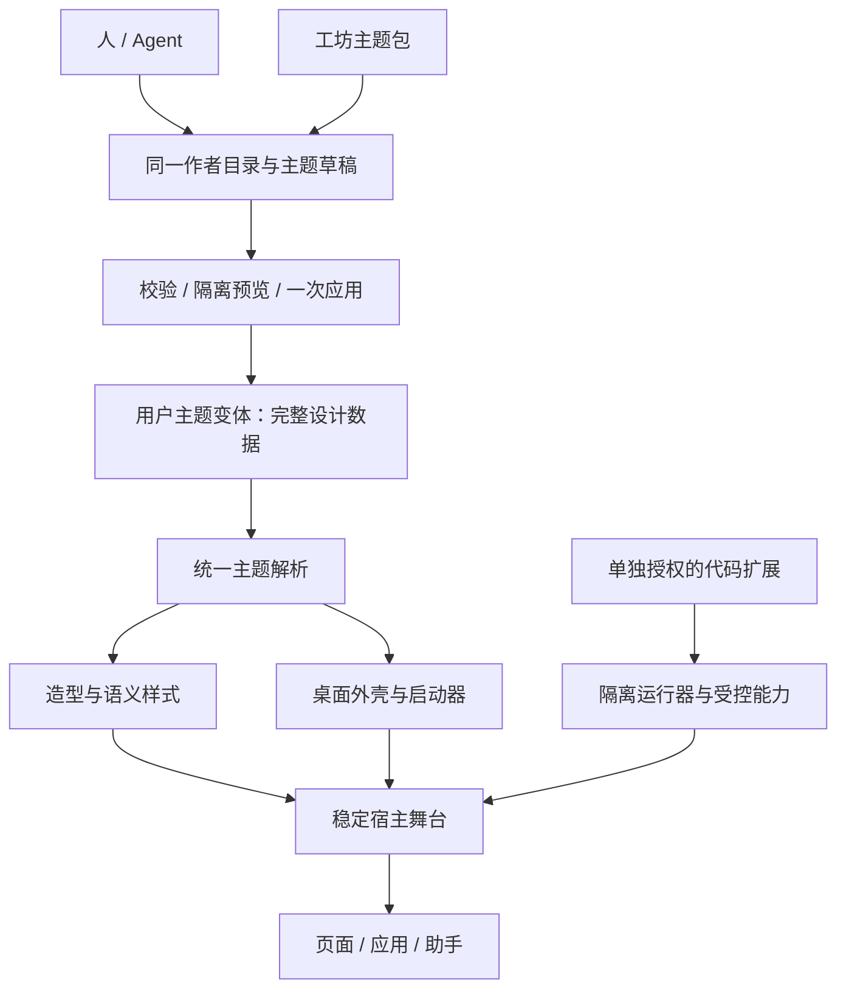

# A3：深度主题、Agent 定制与创意工坊

日期：2026-10-30。审查基线：`27358e2`，main。本文保留该基线的设计研究；分层开放的产品方向已接受。后续第一阶段已实现主题身份、完整派生与保存往返，当前行为见[运行时契约](../../specs/runtime-contract.md#主题外观与模板)；稳定宿主、作者预览与本地包仍为后续提案。

## 判断

当前主题适合改配色和字体，却没有把深度桌面作为一个可扩展模块。新增深度主题会继续修改 App、设置、CSS、工具说明和数据校验。应把切入点放在**主题设计数据、桌面外壳和宿主业务运行所有权**之间。创意工坊在这个基础上做分发，不能反过来用一个通用 plugin loader 解决现有耦合。

用户已选择：[声明式主题 + 单独授权并隔离的代码扩展](../../decisions/0005-layered-theme-extensibility.md)。目标不是限制所有主题只有颜色，而是让造型、密度、布局组合和交互参数成为宿主明确支持的作者能力；全新逻辑由另一个信任层承载。

## 研究基线确认的问题

| 问题 | 代码证据 | 具体影响 |
| --- | --- | --- |
| 实例 ID 同时选择皮肤与桌面 | [App](../../../src/App.tsx#L313)、[ThemeEntry](../../../src/lib/workspace.ts#L286)、[tweakTheme](../../../src/lib/themes.ts#L256) | 内置主题另存为 custom-1 后，iOS/Switch/Win98 的皮肤和交互关联丢失。 |
| 派生不保留完整基础设计，写入不等于生效 | [themes](../../../src/lib/themes.ts#L239) | 共享 main patch 被原模式 main 遮盖；原共享尺寸和字体不完整继承，Agent 缺少有效值来源资料。 |
| 外壳协调散在主应用 | [状态](../../../src/App.tsx#L93)、[导航](../../../src/App.tsx#L230)、[渲染](../../../src/App.tsx#L740) | 增加新桌面要修改业务控制器，而不是新增一个独立实现。 |
| 设置依据具体主题 ID 判断能力 | [外观设置](../../../src/components/ThemeSettings.tsx#L34)、[设置呈现](../../../src/components/SettingsPage.tsx#L71) | 新外壳需要逐个修改设置分支。 |
| 模板读取会误选主题 | [readTemplates](../../../src/lib/workspaceStore.ts#L135) | 隔离执行真实代码，my-custom 读回成 ios；首个非 default 并不是快照指定的主题。 |
| 生命周期尚不统一 | [Switch 分支](../../../src/App.tsx#L871)、[稳定助手分栏](../../../src/components/AssistantSplitPane.tsx#L16) | Switch 启动器替换 PageView；不能声称任意换壳已保留所有临时输入。 |
| 注册表是静态机制 | [registry](../../../src/lib/registry.ts#L115)、[工作空间读取](../../../src/lib/workspaceStore.ts#L67) | 无动态注销/订阅/重复拒绝，未知组件读取时被过滤；缺包不能被当成删除。 |
| 主题样式与预览是全局问题 | [根变量应用](../../../src/App.tsx#L313)、[静态 CSS 导入](../../../src/main.tsx#L17) | 在当前 DOM 直接切 html 预览第二套主题，会同时改变正式页面及弹层。 |

前两项与模板问题已执行真实领域代码的隔离探针，不读写用户数据。详细结果及可复现脚本见任务研究。其余为源码/既有测试审查，本轮未重新运行主题浏览器矩阵。

## 推荐的五层职责

| 层 | 负责 | 不负责 |
| --- | --- | --- |
| 稳定宿主 | 工作空间、路由意图、页面/应用运行器、助手执行、审批、权限和保存门禁 | 具体桌面的菜单、封面选择和装饰几何 |
| 桌面外壳 Shell | 普通导航、主机封面、经典桌面的 chrome、启动器、局部状态与布局规格 | 直接操作存储、读取密钥或重建业务运行器 |
| 主题设计 ThemeSpec | 造型引用、Shell 引用、双模式语义 token、部件 recipe、公开外壳配置、受控资源 | 任意 JavaScript、工作空间内容、应用业务数据 |
| 用户主题变体 | 独立实例 ID、名称、修订与完整设计快照、来源记录 | 用实例 ID 推断渲染实现，或运行时多层主题继承 |
| 工坊包 | 分发定义和资源、依赖与版本、安装/启用/停用/卸载状态 | 仅凭 manifest 自称获得宿主能力 |

**实例 ID、造型 ID、外壳 ID、包 ID 分开。** iOS、纸张、掌机可以共用普通外壳但使用不同造型；Switch 和 Win98 使用不同外壳。用户的“紫色主机”可以保留 Switch 外壳和原造型，仅改变设计数据。并非任意造型与外壳都可以混搭，组合需通过各自声明的合同校验。

主题派生建议保存完整可序列化设计快照，而非只有新改的一项；来源版本用于追踪，升级基础主题不自动重写用户变体。这样不会在未来形成难以解释的主题继承树。渲染只产生一份统一的 ResolvedTheme，说明有效值、来源、当前能力及实际回退状态。

## 外壳接口：业务舞台稳定，桌面呈现可换

推荐 `ShellHost` 作为模块：调用方只提供只读导航模型、受控意图和已解析设计。普通/Switch/Win98 是其内部可替换实现。导航模型由一处投影产生，外壳可以用封面、图标或列表呈现同一批语义入口；设置差异通过能力和 schema 表达。

不要直接实现 `<ActiveShell>{PageView}</ActiveShell>` 后替换 ActiveShell 类型。业务内容应留在同一个宿主父节点；启动器、标题栏、任务栏作为同层呈现切换，通过有限布局规格为舞台划出区域。应用窗口、助手和审批保持可信宿主所有权。

目标合同是：换配色不重挂业务；换外壳仅销毁旧菜单/拖动/订阅，保留当前业务目标、应用 canonical ID、输入和助手执行。启动器或最小化隐藏内容时要同步 inert、焦点与检查器状态。关闭与最小化不同；应用 surface 变化继续按现有持久化保证，不借本轮承诺任意运行形态零重挂。

这与 React 按树中位置与类型关联状态的模型相符；仅保留同一个 key 无法抵消父组件类型被替换。[React 官方说明](https://react.dev/learn/preserving-and-resetting-state)。

## Agent 友好的主题创作

一份字段目录同时服务运行校验、表单、Agent 发现、示例和读回诊断。字段必须包含类型、范围、默认值、适用外壳、模式作用域、用途和版本。目录应覆盖语义颜色、字体/尺度、部件状态 recipe、外壳公开配置和资源，而不是只罗列 CSS 变量。

推荐创作链：

1. 发现当前主题与可用能力，读取允许字段及有效值来源。
2. 从一个已安装主题创建独立草稿，完整保留造型和外壳。
3. 用显式 shared/light/dark 或外壳配置作用域修改；非法字段整次拒绝。
4. 在隔离宿主预览中检查控件、设置、导航和窗口；不启动第二份真实业务或同步。
5. 应用前校验草稿、主题修订和依赖；资源准备失败保留当前主题，成功一次提交并可撤销。

配置验证、有限几何检查和截图审美验收分别报告。现有 inspect_page 没有截图能力，不把目录扩展说成 Agent 自动看见界面。`docs/design-system.md` 保留单一运行时正文，详细主题参数通过按需目录发现，不将全部未来主题知识塞进主提示词。

## 创意工坊的开放方式

| 扩展 | 首选路径 | 热插拔含义 |
| --- | --- | --- |
| 配色/材质/字体/部件造型 | 声明式设计数据与受控资源 | 运行时安装并启用，不重启业务 |
| 已支持外壳的布局和交互参数 | 受控 shell 配置与组合 | 当前 renderer 解释数据，无需发布新宿主 |
| 全新的可信桌面交互 | 仓库内 Shell adapter | 开发者新增实现后重新构建；运行时可切换已打包外壳 |
| 第三方执行逻辑 | 单独授权的隔离 runner | 停启会话、取消请求、保存确认和资源释放都有合同 |
| 任意第三方完整桌面代码 | 以后独立设计受限 Shell runner | 当前 App iframe 不能直接托管父 React 节点，不能承诺下载即替换整个宿主 |

MV3 普通扩展页当前实际 CSP 只允许 self 脚本；sandbox 是不同权限和通信模型。宿主远端模块导入与沙盒内运行不是同一个方案。[本项目 manifest](../../../browser-extension/manifest.json#L39)、[Chrome CSP](https://developer.chrome.com/docs/extensions/reference/manifest/content-security-policy)、[sandbox](https://developer.chrome.com/docs/extensions/reference/manifest/sandbox)、[远端代码说明](https://developer.chrome.com/docs/extensions/develop/migrate/remote-hosted-code)。本轮不作商店上架合规承诺。

首个本地包再实现 manifest、不可变版本/摘要、资源目录与预算、依赖检查、安装/启用分离、缺包保留和更新失败恢复。摘要用于一致性，不等于作者可信。新设备缺少扩展应保留实例数据并提示安装，不能同步后直接运行代码或复制设备授权。

## 实施顺序

| 阶段 | 可观察的结果 | 验收重点 |
| --- | --- | --- |
| 1. 主题身份与派生 | 对搭搭说“把主机改成紫色”，保留主机外壳并真正生效 | 完整双模式/字体/造型；改名、撤销、重载、模板、备份和同步往返 |
| 2. 稳定宿主与外壳 | 新增一个内置深度主题，不再修改 App 与设置的主题 ID 分支 | 三种现有外壳、导航、窗口、助手审批、输入保持、失败回退 |
| 3. 作者目录与预览 | Agent 和手动设置使用同一合同，草稿可看、可改、可取消、可应用 | schema、冲突、资源与 portal 隔离、一次提交 |
| 4. 本地声明式主题包 | 用户导入包即可安装、启用、停用、卸载 | 依赖版本、缺包保留、更新失败、资源预算与备份范围 |
| 后续独立里程碑 | 第三方代码扩展及在线工坊 | capability、runner、授权、升级；再做账户/分发/审核等服务 |

首轮不新建通用插件 SDK、任意 JSX 生成器、多窗口任务系统或在线工坊服务。目录、版本和权限合同应在真实变化需要时补齐；共享设计数据不等于所有执行过程使用一套巨型插件接口。

## 方案比较与选择

- **继续主题 ID 条件分支**：短期开发最快，但派生/设置/Agent/后续包仍需跨处修改，不符合本次目标。
- **全桌面声明式 DSL**：适合后续低代码工坊，但现在要一次定义焦点、拖放、窗口、布局和事件协议，成本与风险过高。
- **任意同源 React 插件**：创作自由高，同时扩大宿主权限并与扩展平台约束冲突，不符合已接受的分层开放方向。
- **稳定宿主 + 可信 Shell + 声明式 ThemeSpec**：能用现有三个外壳验证真实差异，直接改善开发者和 Agent；推荐作为 A3 主线，再逐步增加可分发贡献种类。

## 任务与证据

[父任务](../../../.trellis/tasks/10-30-theme-shell-architecture/prd.md)下拆四项纵向交付，全部保持 planning。详细 [Interface 与生命周期设计](../../../.trellis/tasks/10-30-theme-shell-architecture/design.md)、[实施与验收计划](../../../.trellis/tasks/10-30-theme-shell-architecture/implement.md)。

专项证据：[外壳结构](../../../.trellis/tasks/10-30-theme-shell-architecture/research/shell-structure.md)、[作者与 Agent](../../../.trellis/tasks/10-30-theme-shell-architecture/research/theme-authoring.md)、[工坊合同](../../../.trellis/tasks/10-30-theme-shell-architecture/research/workshop-contract.md)。
